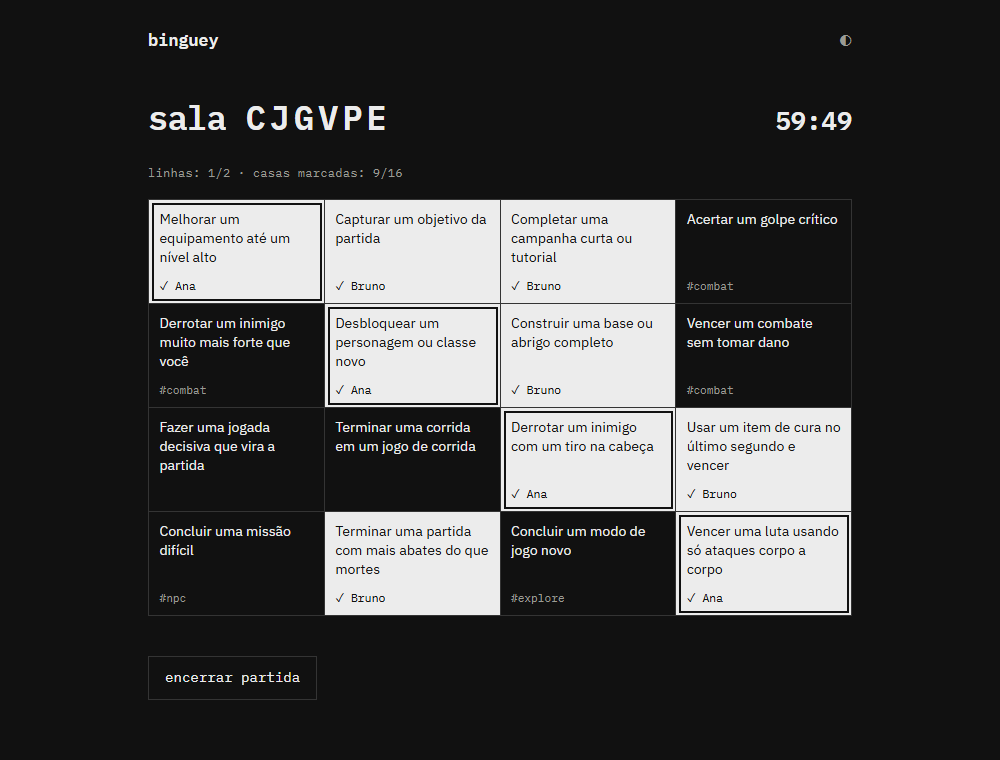
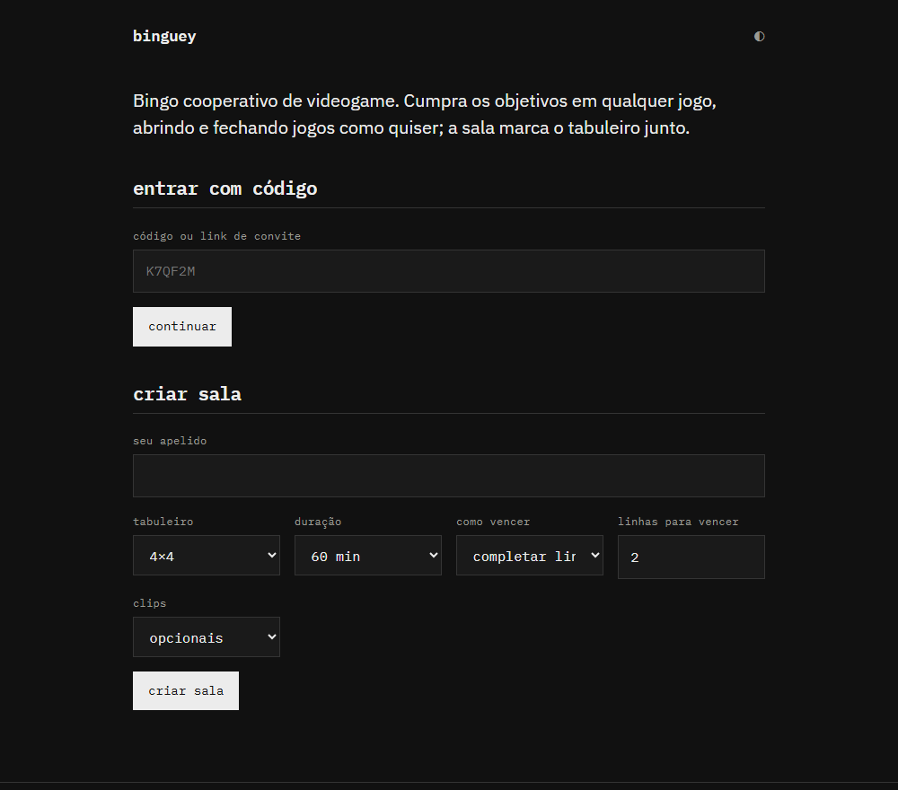
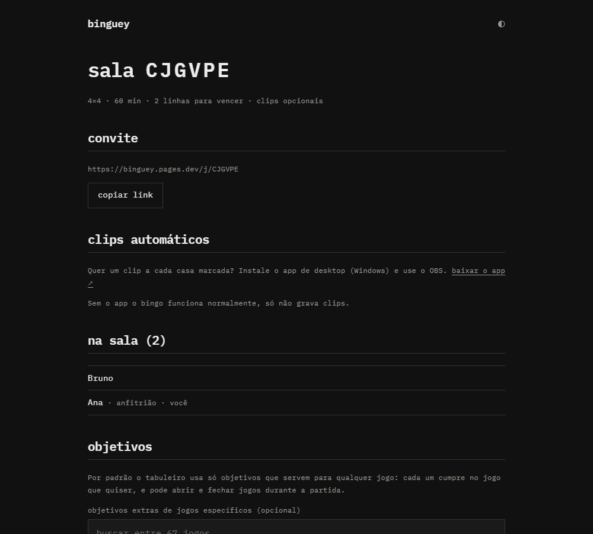
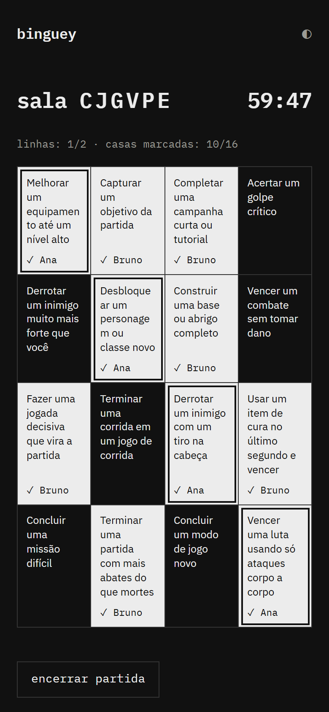
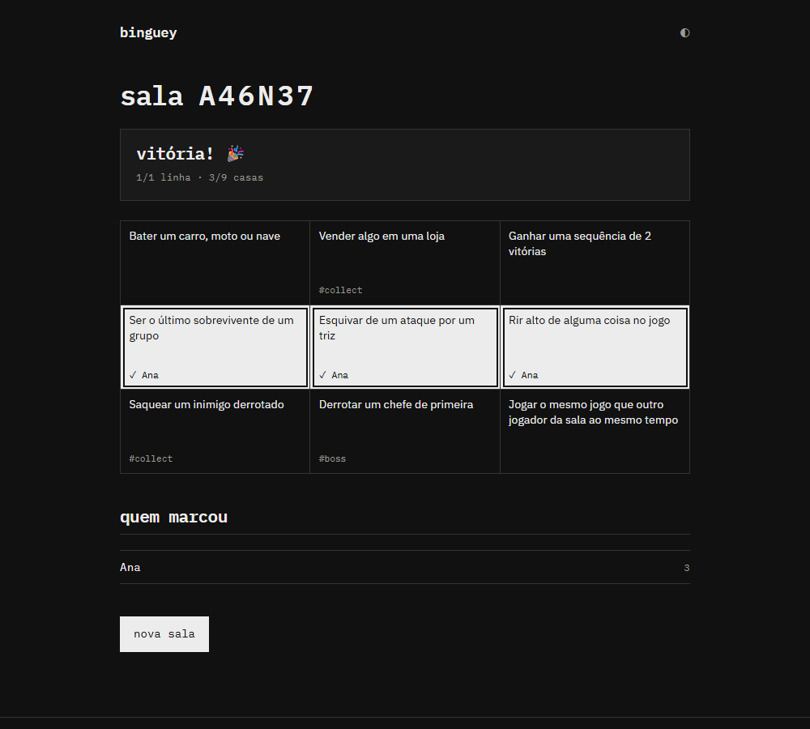
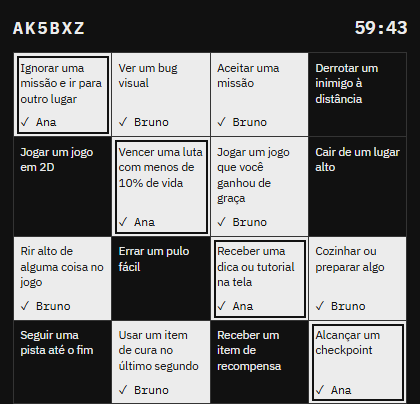

# Binguey

**Bingo cooperativo de videogame.** Cumpra os objetivos do tabuleiro em *qualquer* jogo, abrindo e fechando jogos como quiser, e a sala marca tudo junto, em tempo real. Com o app para Windows, cada casa marcada ainda vira um **clip automático** de até 20 segundos, e no fim sai um vídeo com os melhores momentos.

**[▶ Jogar agora](https://binguey.pages.dev)** · [⬇ Baixar o app para Windows](https://github.com/Pedrocs50/binguey/releases/latest)

> Projeto em desenvolvimento (versão 0.1). Já dá para jogar de verdade; ainda estamos testando com amigos.

---

## Jogue em 1 minuto, sem instalar nada

1. Abra **[binguey.pages.dev](https://binguey.pages.dev)**, no computador ou no celular.
2. Digite um apelido (sem e-mail, sem senha) e clique em **criar sala**.
3. Copie o **link de convite** e mande para os amigos. Quem abrir o link só precisa digitar um apelido e entrar.
4. O anfitrião clica em **iniciar partida**. O tempo começa a correr.

## Como funciona o bingo

- **O tabuleiro tem objetivos que servem para qualquer jogo**, como "derrotar um chefe sem usar cura", "concluir uma missão difícil", "vencer uma partida online" ou "concluir uma fase em um jogo 2D". Cada um joga o jogo que quiser e pode trocar de jogo no meio da partida.
- Quando você cumpre um objetivo, **toque na casa**. Ela fica marcada com o seu nome para todos. **Quem marca primeiro fica com a casa.**
- Ao criar a sala, o anfitrião escolhe **como vencer**: **completar um número de linhas** (linha, coluna ou diagonal) ou **cartela cheia** (todas as casas marcadas). A sala precisa vencer antes de o tempo acabar. Dá para jogar em tabuleiros 3×3, 4×4 e 5×5.
- O anfitrião pode **escrever objetivos próprios** e incluir objetivos extras de **67 jogos** (Minecraft, Elden Ring, CS2, Valorant, Hollow Knight, Baldur's Gate 3 e muitos outros). São mais de **600 objetivos** no total, todos de conquista: concluir missões e fases, derrotar chefes, vencer partidas.
- O anfitrião pode **encerrar a partida** a qualquer momento.

## Clips automáticos (opcional, Windows + OBS)

Sem o app o bingo funciona normalmente. Com o app, **cada casa marcada salva automaticamente os últimos 20 a 40 segundos de gameplay** (você escolhe) e o clip aparece para a sala toda. Ao final você pode montar um **vídeo com os melhores momentos**, com legenda do objetivo e de quem marcou.

### O que você precisa
- Windows 10 ou 11.
- O **[OBS Studio](https://obsproject.com/pt-br)** (versão 28 ou mais nova) instalado.

### Como começar
1. Baixe o instalador em **[Releases](https://github.com/Pedrocs50/binguey/releases/latest)** (arquivo `Binguey_..._x64-setup.exe`) e execute.
   O Windows pode mostrar *"O Windows protegeu o seu PC"*, porque o instalador ainda não tem assinatura digital paga. Clique em **Mais informações → Executar assim mesmo**. O instalador é gerado pelo GitHub a partir do código deste repositório, e o arquivo `sha256.txt` da mesma página permite conferir a integridade.
2. Abra o **Binguey**, crie uma sala ou entre por um link de convite (links `binguey://` abrem o app direto).
3. O app **conecta ao OBS sozinho**: abre o OBS se ele estiver fechado, lê a senha da configuração dele e prepara tudo. Você não precisa configurar nada.
4. Jogue. Quando cumprir um objetivo, aperte **`Ctrl+Shift+B`** para abrir o **mini-tabuleiro** por cima do jogo, clique na casa e continue jogando.

### O que o app faz no seu OBS (sem bagunçar o seu)
- Cria um **perfil e uma cena chamados "Binguey"** (30 fps, e a qualidade que você escolher) e **devolve o seu perfil e a sua cena** quando você desativa os clips ou fecha o app. Se você estiver transmitindo ou gravando, ele não mexe em nada.
- **Áudio:** o som do jogo é sempre gravado; o seu **microfone só entra se você marcar** a opção no painel de clips (desligado por padrão, por privacidade).
- Você escolhe a **qualidade dos clips**: 20, 30 ou 40 segundos, em 720p (uns 8 MB por clip de 20 s) ou 1080p (uns 25 MB por clip de 40 s). Clips maiores gastam mais do armazenamento gratuito da sala (limite de 400 MB por sala); o que passar disso fica só no seu computador.
- Você escolhe **o que gravar**: *qualquer jogo* (grava o monitor principal, funciona com qualquer jogo, mas também mostra notificações e outras janelas), *só o jogo em tela cheia* (Captura de Jogo do OBS) ou *a sua própria cena*.
- Os arquivos dos clips ficam guardados no seu computador, em **Vídeos\Binguey**, para você guardar seus momentos. Há botões para abrir a pasta e para limpar, e uma opção para apagar cada arquivo depois de enviado.

### Vídeo final
Na sala encerrada, clique em **montar vídeo final**. O app escolhe até 10 clips (os das linhas vencedoras primeiro, depois os de todos os jogadores) e monta um vídeo com legendas, na mesma resolução dos clips (720p ou 1080p), **no seu computador**. Ele usa o [ffmpeg](https://ffmpeg.org); se você não tiver, o app oferece instalar pelo `winget`.

## Privacidade

- **Não há conta, e-mail nem senha.** Você entra com um apelido.
- **Clips são privados da sala:** só quem está na sala consegue ver. Eles são **apagados automaticamente do servidor** cerca de 24 horas depois do fim da partida, e você pode apagar os seus a qualquer momento.
- Os clips mostram o que o OBS está gravando. No modo "qualquer jogo", isso inclui o monitor inteiro: **feche o que for pessoal** ou use o modo "só o jogo em tela cheia".
- A senha do OBS **nunca sai do seu computador**.

## Perguntas frequentes

**Preciso do app para jogar?** Não. O bingo funciona 100% no navegador. O app só adiciona os clips.

**Funciona em Mac ou Linux?** O jogo no navegador, sim. O app com clips é só para Windows por enquanto.

**O jogo ficou preto no clip.** Alguns jogos em tela cheia exclusiva não deixam o OBS capturar. Use o modo "qualquer jogo" ou rode o jogo em **janela sem bordas**.

**O mini-tabuleiro minimizou o meu jogo.** Em jogos em tela cheia exclusiva o Windows pode minimizar o jogo ao abrir outra janela. Use a janela sem bordas.

**Quanto tempo as salas duram?** Uma sala expira 48 horas depois de criada.

**É gratuito?** Sim, e foi pensado para continuar assim.

## Para quem quer mexer no código

Documentação técnica, como rodar localmente, testes e como publicar versões: **[docs/DESENVOLVIMENTO.md](docs/DESENVOLVIMENTO.md)**. A análise de arquitetura está em [docs/analise-inicial.md](docs/analise-inicial.md).

A biblioteca de objetivos fica em [`supabase/goals/library.mjs`](supabase/goals/library.mjs): sugestões de objetivos e de jogos são muito bem-vindas.
